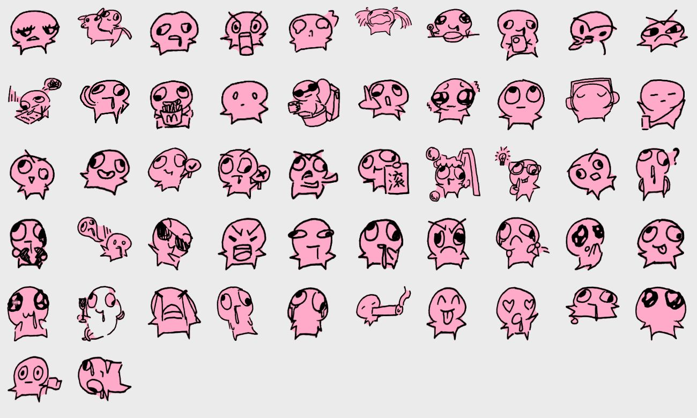

# danmaku — Cute Sticker Danmaku Wallpaper

A colorful, interactive **danmaku (bullet-comment) wallpaper & mini-game** for phone, tablet and desktop browsers.
It turns a sheet of hand-drawn black-and-white emoji doodles by **叶源源 (Ye Yuanyuan)** into 50+ glittery, color-shuffled stickers that
float across the screen together with wild, abstract scrolling text.

Pure static web app — no build step, no dependencies.



## Features

- **Auto-colored stickers** — every sticker is re-colored at runtime (gradients, dots / stripes / hearts / stars / grid patterns,
  random ink color, white die-cut border, glossy highlight), plus blush, glitter and twinkling sparkles.
- **Accessories fly onto faces** — 13 hand-coded sparkly props (bow, crown, cat ears, halo, flower, star clip, headphones,
  earrings, heart sunglasses, phone with charm strap, bubble tea, pearl necklace, magic wand) drift in, land on a sticker, then float away.
- **Abstract, exaggerated danmaku text** — meme-style copy rendered with 8 effects (jelly, rainbow wave, shake, gradient,
  bounce, vertical rain, neon, stamp) and 6 bundled open-source display fonts.
- **Playful interaction** — tap to make stickers jump and talk, drag & fling them, tap empty space to summon more,
  double-tap for fireworks, shake your phone to scatter everything, mouse-shy stickers on desktop.
- **Mini-game "Pop the bubbles"** — 30 seconds, combos, rainbow bonus stickers.
- **Background music** — 5 original procedurally generated anime-flavored tracks (WebAudio, no copyright issues),
  plus your own mp3s via `music/playlist.json` or the in-app file picker. Stickers bounce to the beat.
- **6 color themes**, 4 flow directions (horizontal / rising / falling / drifting), speed & density sliders,
  send-your-own-danmaku box, save-as-PNG wallpaper, fullscreen, installable as a PWA (offline capable).

## Run it

Browsers block local image loading from `file://`, so serve the folder over HTTP:

```bash
python -m http.server 8765
# then open http://localhost:8765
```

On Windows you can just double-click `启动.bat` (also prints how to open it from a phone on the same Wi-Fi).
To use it on a phone/tablet permanently, host the folder on any static host (GitHub Pages, Netlify, ...)
and "Add to Home Screen".

Handy URL hashes: `#night`, `#sunset`, `#up`, `#rain`, `#drift`, `#game`, `#many` (lots of props/text), `#music0`…`#music4`.

## Project layout

| Path | Purpose |
| --- | --- |
| `index.html`, `app.js` | UI, physics, rendering, interaction, mini-game |
| `props.js` | Procedurally drawn accessories |
| `music.js` | WebAudio music engine (5 generative tracks + local files) |
| `stickers/` | 52 sprites: `NN_ink.png` (line art) and `NN_fill.png` (silhouette mask) |
| `fonts/` | Subsetted open-source (SIL OFL) display fonts + `subset.py` |
| `extract.py` | Cuts the scanned doodle sheet into individual stickers (OpenCV) |
| `make_icon.py` | Generates the PWA icons |
| `sw.js`, `manifest.webmanifest` | Offline cache / installable app |

## Re-generating stickers from your own sheet

```bash
pip install opencv-python-headless numpy
# put your scanned sheet at ../sheet.jpg (or edit SRC in extract.py), then:
python extract.py
```

`extract.py` thresholds the ink, separates each doodle with morphological grouping, fills the silhouette
and writes ink/fill PNG pairs into `stickers/`. The loader in `app.js` picks them up automatically
(adjust `COUNT` if you have more than 52).

## Credits & licensing

- **Code** (`*.js`, `*.html`, `*.py`, `*.bat`): MIT License, see `LICENSE`.
- **Sticker artwork** (`stickers/`, `preview_sheet.jpg`): hand-drawn by **叶源源 (Ye Yuanyuan)**, published here with the artist's permission. **All rights reserved by the artist.**
  Please do not reuse the artwork without permission; swap in your own doodles via `extract.py` to build your own version.
- **Fonts** in `fonts/`: ZCOOL KuaiLe, ZCOOL QingKe HuangYou, Ma Shan Zheng, Zhi Mang Xing, Liu Jian Mao Cao, Long Cang —
  all under the SIL Open Font License 1.1 (via Google Fonts).
- Built-in music is generated at runtime by `music.js` and is original.
